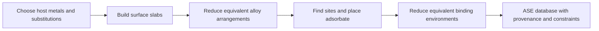

# Intergen

A catalyst’s behavior depends on which atoms surround the place where a molecule binds. For alloys containing three metals, changing both the metal identities and their arrangement creates many possible binding environments. Building these structures by hand makes systematic comparison difficult and can repeat equivalent sites or miss distinct ones.

Intergen generates alloy surface models and places an adsorbate—an atom or molecule bound to a surface—at distinct candidate binding sites. It uses crystal symmetry and structural matching to reduce equivalent arrangements, producing a traceable collection of starting geometries for subsequent calculations.

Intergen was used to generate the trimetallic surface and binding-site dataset for [*Few-Shot Ensemble Learning for Catalysis and Application to Trimetallics for Oxygen Reduction*](https://doi.org/10.1021/acscatal.5c08168) (Hill, Ruiz-Escudero, and Montemore, 2026). Its contribution is structure generation; the publication’s energy predictions and screening results require calculations outside this repository.



## Capabilities

- Build periodic slabs—thin crystal models of a surface—for face-centered cubic (111), body-centered cubic (111), and hexagonal close-packed (0001) surfaces.
- Enumerate substitutions of host atoms, including two different substituents that create trimetallic surfaces with neighboring or separated alloy atoms.
- Discover atop, bridge, and hollow adsorption sites and remove equivalent adsorbate–slab structures under configurable matching criteria.
- Save structures in an Atomic Simulation Environment (ASE) database with parent-slab identifiers, substitution history, initial site information, and optional fixed bottom layers.

**Scope:** “unique” refers to the configured search space and matching criteria, not every physically possible binding geometry. The current motif classification supports at most two non-host atoms in the top layer. Intergen does not relax structures, calculate adsorption energies, or establish alloy stability. See [scientific limitations](docs/configuration.md#scientific-scope-and-limitations) before expanding a search.

## Quickstart

Use Python **3.11 or newer**. From a checkout of this repository, install the runtime dependencies and package:

```sh
python3 -m venv .venv
source .venv/bin/activate
python -m pip install -r requirements.txt
```

Run a minimal example: nitrogen on pure Pt(111). The separate run directory preserves your existing `config.toml`; the CLI always reads that filename and a relative `assets/` directory.

```sh
mkdir -p quickstart-run/data
cp docs/examples/quickstart.toml quickstart-run/config.toml
cp -R assets quickstart-run/
cd quickstart-run
python -m intergen
```

Inspect the generated database from the same directory:

```sh
python - <<'PYTHON'
from ase.db import connect

db = connect("data/quickstart.db")
print(f"{db.count()} adsorbate–slab structures")
row = next(db.select())
print(row.adslab_id, row.parent_slab_id, row.initial_site_label)
print(row.data["structure_metadata"])
PYTHON
```

To generate Pt–Cu–Ag surfaces next, use the [trimetallic example](docs/examples/trimetallic.toml); alloy enumeration and matching can take substantially longer.

A populated output database is reused on subsequent runs, even if generation settings change. Choose a new `database.path` for a new search. Existing databases may be rewritten to add missing bottom-layer constraints. See [configuration and run behavior](docs/configuration.md).

## Documentation

Start with the [documentation index](docs/README.md) for configuration, scientific limitations, and implementation details.

<!-- Preserve anchors from the original README. -->
<a id="structure-metadata"></a>
<a id="bulk-constraints"></a>
<a id="adsorbate-matching"></a>
<a id="adsorption-site-template-reuse"></a>

- [Structure metadata and database queries](docs/metadata.md)
- [Bulk constraints](docs/constraints.md)
- [Adsorbate matching and adsorption-site template reuse](docs/site-generation.md)
- [Installation notes and development checks](docs/development.md)

## Related projects

Intergen supplies candidate geometries. [Oasis](https://github.com/SiliconScientist/oasis) focuses on experiments that refine predictions from machine-learned interatomic potentials using sparse reference data. Oasis identifies [Moirai](https://github.com/SiliconScientist/Moirai) (referred to as Moira) as its related project for model ingestion and prediction.

These are complementary roles, not an automated pipeline provided by Intergen. This repository writes ASE databases and contains no direct Oasis or Moirai integration; transferring structures, predictions, and identifiers requires a separately configured workflow.
